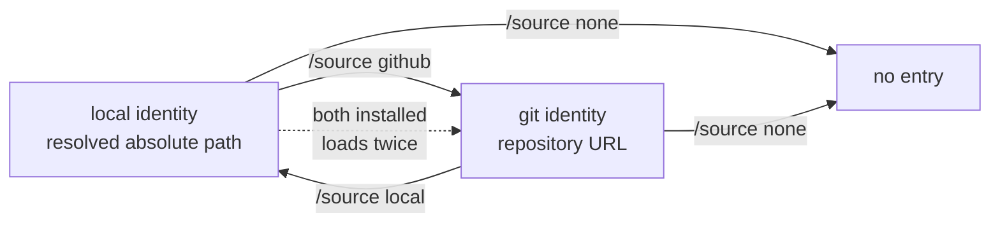

# Architecture

`pi-source` is one Pi extension and one command. `index.ts` re-exports `src/index.ts`, which parses the argument, resolves state, asks `plan.ts` what to do, and either prints that plan or runs it.

## Module layout

| Path | Responsibility |
|---|---|
| `index.ts` → `src/index.ts` | Entry point: argument parsing, autocomplete, the execute loop, `ctx.reload()`. |
| `src/git.ts` | Every subprocess and the one pure parser: `repoRoot`, `originSource`, `workNote`, `remotePath`. |
| `src/state.ts` | What is installed now: reads `settings.json`, resolves stored entries, `hasPiManifest`. |
| `src/plan.ts` | The vocabulary (`State`, `Mode`, `Step`) and the decision: `planSwitch`, `describe`, `renderPlan`. |

`plan.ts` imports nothing from `git.ts` or `state.ts`. That is the whole point of the split — see below.

## Two identities, one extension

Pi loads the extension once per identity, so both together register `/source` twice and every tool twice. Every switch therefore ends with exactly one entry — or, for `none`, with none at all.

## Plan, then execute

`planSwitch(state, mode)` returns a `Step[]`, or an `{ error }` for the refusals. It does not execute, read the filesystem, or import pi. `switchTo` then either renders that array or loops over it.

Two consequences worth keeping:

- **The dry run cannot drift.** It prints the same array the executor consumes; a hand-rolled preview that re-derived the commands would eventually lie.
- **The ordering invariant is testable.** Install precedes remove, and reversing it would leave nothing installed when the install fails. `test/plan.test.ts` asserts the order on a literal `State`, no fixtures, no harness.

`none` is the degenerate member of the same vocabulary: it has no install step, so its plan is whichever removes apply, and it skips the `hasManifest` and origin refusals — those guard *installing* something pi cannot load, not removing something it can.

`State` carries both what is true (`repoRoot`, `gitSource`, `local`, `github`) and what was found in settings (`localEntry`, `githubEntry`) so that reporting never re-reads the file.

## Resolving a local entry

Pi stores a local declaration **relative to the settings file**, so an entry read back from `~/.pi/agent/settings.json` is a path like `../../../Code/github.com/S1M0N38/pi-source`. `resolveEntry` expands `~` and resolves against the agent dir; `realPath` then canonicalises both sides, so a symlinked checkout still matches the entry that points at it.

A git entry matches its bare source and any ref suffix: `git:github.com/S1M0N38/pi-source@v1` is the same package as `git:github.com/S1M0N38/pi-source`.

## Subprocesses

`pi.exec` without a shell, always with an explicit `cwd` — `/source` acts on the repository the session started in, which is not necessarily the process working directory.

| Call | When | Failure |
|---|---|---|
| `git rev-parse --show-toplevel` | every invocation | falls back to `cwd` |
| `git remote get-url origin` | every invocation | no origin: `github` mode refuses |
| `git rev-parse --abbrev-ref @{upstream}` | every invocation | no upstream: the ahead count is skipped |
| `git rev-list --count @{upstream}..HEAD` | only with an upstream | skipped |
| `git status --porcelain` | every invocation | note omitted |
| `pi install <source>` | when the requested mode is not installed | message, remaining steps skipped |
| `pi remove <source>` | when the other mode is installed, or either mode for `none` | message naming the drift |

Five read-only git calls before anything is written; a `/source` report is four to five subprocesses and touches no state.

## Settings are written by pi

The extension never writes `settings.json`. It shells out to `pi install` and `pi remove` so normalisation — relative paths, deduplication, scope — stays in one place.
